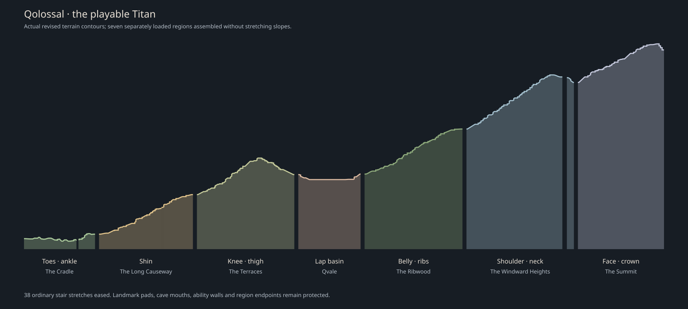

# Qolossal world refresh — 4 November 2026

Integrated across all seven regions and 89 underground rooms. Native 4K environment resolution, local walking, cave landings and live map checks passed; see the scoped evidence below.

## Actual Titan profile

The profile uses the actual revised upper terrain with equal X/Y scale and seven anatomy labels. It is a review illustration, not a map geometry replacement. [Profile generator](titan_profile.py).

This review covers seven surface regions, their 84 zones and the 89-room underground network. Applied counts and test statuses come from saved operation and validation receipts.

38 connectors applied across all seven regions; static validation reports 0 errors.
89 room records, 93 rounded terrain pieces and 629 painted pieces in the underground application receipt.

## Regional themes

| Region | Titan structure | Environment | Protected gameplay |
|---|---|---|---|
| MR01 · Cradle | Toes, foot hollows and ankle | Sheltered mossy spring basin, pale rounded limestone, fern banks and tiny woodland shelters | Grip shrine, quake crossing and catching floor |
| MR02 · Long Causeway | Ascending shin | Weathered road-stone over an aqueduct gorge, rooted waystation ruins and high cisterns | Living Thread lift wall and its approach |
| MR03 · Terraces | Kneecap crest and descending thigh | Honey limestone orchard shelves, irrigation channels, old mills and cascading sluices | Sluice gate and lintel; Bloomfall progression |
| MR04 · Qvale | Sheltered lap basin | A warm-spring river town, flowering gardens and the listening tree | Buildings, shops, doorways and town services |
| MR05 · Ribwood | Belly rise and rib ridges | Ancient root bridges, fern gardens and forest canopy beneath sweeping stone arches | Wind Leaf shrine and deliberate climbing walls |
| MR06 · Windward Heights | Shoulder crest, collarbone and neck dip | The approved river valley: wooded islands, waterfalls, weathered arches and wind-worn ivory limestone | Glidecap shrine, glide gorge and catching floor |
| MR07 · Summit | Chin, face, brow and crown | Pearl limestone, pale alpine flowers, reeds, turquoise high lakes and waterfall shelves | Reveal ledge, lake shore and ending approach |

The Titan relationship is expressed through the real route, stone folds and natural arches. It does not restore the superseded illustrated Titan contour or place a literal giant portrait behind every level.

## Terrain and cave approaches

The surface design eases ordinary repeated risers into connectors where space and protected footprints allow. The source plan caps new grade at 1.0 and displacement from the previous local walkline at 3.2 units. Deliberate climbing walls, ability gates, beat pads, entrances, arrivals and encounters remain protected. Cave placement changes must be supported by actual clearance evidence; moving a mouth merely for visual symmetry is not part of the plan.

| Region | Applied connectors | Static errors | Evidence |
|---|---:|---:|---|
| MR01 · Cradle | 2 | 0 | [applied](Surface/MR01_applied.json) · [checks](Surface/MR01_validation.json) · [plan](Surface/MR01_plan.json) |
| MR02 · Long Causeway | 9 | 0 | [applied](Surface/MR02_applied.json) · [checks](Surface/MR02_validation.json) · [plan](Surface/MR02_plan.json) |
| MR03 · Terraces | 9 | 0 | [applied](Surface/MR03_applied.json) · [checks](Surface/MR03_validation.json) · [plan](Surface/MR03_plan.json) |
| MR04 · Qvale | 3 | 0 | [applied](Surface/MR04_applied.json) · [checks](Surface/MR04_validation.json) · [plan](Surface/MR04_plan.json) |
| MR05 · Ribwood | 7 | 0 | [applied](Surface/MR05_applied.json) · [checks](Surface/MR05_validation.json) · [plan](Surface/MR05_plan.json) |
| MR06 · Windward Heights | 3 | 0 | [applied](Surface/MR06_applied.json) · [checks](Surface/MR06_validation.json) · [plan](Surface/MR06_plan.json) |
| MR07 · Summit | 5 | 0 | [applied](Surface/MR07_applied.json) · [checks](Surface/MR07_validation.json) · [plan](Surface/MR07_plan.json) |

These counts are application receipts. See [surface design](Surface/DESIGN.md). Underground work retains the 89-room physical network and 63 passages; recorded arrival/checkpoint adjustments are in [landing repairs](Underground/landing_repairs.json). Static collision screening remains separate from live settling and full traversal.

## Underground themes

| Set | Theme | Environment |
|---|---|---|
| A | The Sluice Cisterns | deep teal limestone cistern galleries inside a colossal petrified body; graceful natural vaults echo rib-like stone strata, abandoned tiny water channels and arch bridges, soft waterfall ribbons into scattered reflective pools, scattered warm amber maintenance lanterns |
| C | The Root Gardens | deep olive and turquoise root garden caverns inside an ancient petrified giant; immense curving roots woven through natural stone vaults, fern groves, pale seed pods, tiny luminous mushrooms, scattered narrow streams and suspended moss islands |
| D | The Wind Hollows | cool blue-grey wind-eroded limestone caverns beneath a shoulder and collarbone; curved vent cavities, thin pale mist ribbons, high ledges with abandoned tiny vane arches and nests, distant cold daylight filtering through hairline crevices |
| E | The Memory Sanctuary | muted violet and warm umber subterranean sanctuary beneath an ancient brow; weathered quiet processional arches, scattered shallow reflecting pools, faded tiny votive stones, drooping pale plants and amber dust motes, intimate sacred hush |
| H | The Great Heart Hall | deep garnet amber and stone-grey heart sanctum; immense concentric fossil-like curved stone vaults and vein-like crystalline seams, scattered distant amber reflections and small ancient balconies, reverent dim light, NO visible actual heart organ or gore |
| MR01 | The Moss Hollows | warm mossy toe-and-ankle hollows of an ancient stone giant; rounded weathered rock cushions, fern-lined natural pockets, tiny forest springs, fireflies and small roots, soft sage green and honey light |
| MR02 | The Resonant Underarches | grey sandstone shin underarches shaped by water and old masons; low carved stone arch remnants, limestone drip pools, abandoned small chisel-work niches and winding silt channels, muted brass and cool teal |
| MR03 | The Sluice Undercrofts | golden ochre knee-and-thigh limestone undercrofts; ancient small mill water channels, eroded terraced cave shelves, seed-store niches, reed clusters and glints of water, warm clay and moss tones |
| MR05 | The Hidden Rib Gardens | olive emerald belly-and-rib hollows; stone folds that sweep like buried ribs softened by woodland roots, hanging seed clusters, mossy streams, tiny amber fungi and far root bridges, natural living sanctuary |
| MR06 | The Sheltered Wind Clefts | pale lavender shoulder and collarbone hollows, smooth sculpted limestone folds, distant little waterfalls, misty wind windows and sparse golden grasses, nests in sheltered alcoves, cool soft blue shadows |
| MR07 | The Pale Echo Chambers | pearl limestone face-and-brow chambers, graceful rounded pale mineral folds, tiny reed-lined silver pools, scattered distant cairns and weathered arches, faint ice-blue crystal seams, quiet dawn rose light |
| P | The Secret Niches | small hidden moss and mineral alcoves inside a weathered stone titan, layered roots and smooth rock hollows, tiny spring rivulets, fern pockets and dim amber fungi, varied muted natural earth and sage tones |

See the [room manifest](Underground/room_manifest.json), [underground handoff](Underground/README.md) and [native asset records](Underground/native_assets.json). Great Heart uses a separate native detail tile; changes to its appearance and state animation require rendered review.

## Exact 4K resolution basis

At 3840 × 2160 and orthographic half-height 5, the frame covers 17.777778 × 10 world units, so the requirement is 216 display pixels per world unit. For an axis-aligned asset: `required width = ceil(world width × 216)` and `required height = ceil(world height × 216)`. For a repeating material, evaluate one tile and its UV/world mapping, not the full wall bounds. Sheared terrain needs the weakest directional sampling rate. The calculation must use imported dimensions and the closest actual supported zoom.

| Asset group | Native dimensions | Intended footprint / mapping | 4K requirement |
|---|---|---|---|
| 12 new surface Far/Mid layers | 2172 × 724 each | 10 × 3⅓ units | 2160 × 720 each |
| Six new terrain top strips, MR02–MR07 | 2172 × 724 each | 360 PPU, 6.033333 × 2.011111-unit tile; maximum slope 1 | Weakest rate 222.49 PPU, above 216 PPU |
| Twelve underground vistas | 1774 × 887 each | 8.212963 × 4.106481-unit tile at 216 PPU | 1774 × 887 each |
| Heart detail tile | 1254 × 1254 | 5.805556 × 5.805556 units at 216 PPU | 1254 × 1254 |

## Review images and evidence

Generation used the built-in image tool. Exact [far prompts](Art/prompts_far.json), [middle prompts](Art/prompts_mid.json), [terrain top prompts](Surface/top_prompts.json), [fill prompts](Art/prompts_fill.json) and [underground prompts/provenance](Underground/native_assets.json) remain reviewable. Accepted sources are retained; new paintings are siblings under `Assets/Art/Prototypes/WorldRefresh_20261104`.

## Platform limits

Targets remain Windows PC, PS5, Xbox Series X and Series S, and Nintendo Switch 2 handheld/docked. Editor screenshots and source-density calculations do not certify 4K output, 60 FPS or console readiness. Standalone builds, physical controller coverage, CPU/GPU frame time, peak memory and console hardware testing remain separate validation gates. Report final tested modes and unresolved items explicitly.

## Measured environment resolution

1,526 active placements, 224 raster assets; 0 native and 0 imported resolution failures.

[Exact 4K audit](RESOLUTION_4K.md) · [Per-asset CSV](asset_resolution_requirements.csv) · [Per-asset JSON](asset_resolution_requirements.json). The full audit gives native/imported dimensions and the exact required canvas using weakest-direction mesh sampling. Sky gradients and geometric doorway outlines rasterize at output resolution. No source bitmap was enlarged to manufacture detail. The environment audit excludes characters, UI, cinematics and disabled alternatives.

## Recorded validation

| Check | Result | Evidence |
|---|---|---|
| Surface live connector smoke | PASS · 38 connector cases, 0 errors, 0 console errors | [receipt](Playtest/surface_playtest_result.json) |
| Underground live placement/settling | PASS · 126 placements checked, 89 checkpoints, 37 return pairs, 0 errors | [receipt](Underground/settle_result.json) |
| Unity map UI tests | Recorded — no explicit overall pass flag · 0 errors | [receipt](Map/ui_tests.json) |
| Final QA | PASS | [receipt](QA.json) |

Missing result files remain pending. The review reads results when regenerated. Image presence is not a test pass.

## Capture galleries and source evidence

[Open the gallery](index.html): 21 surface Editor views, seven surface Play-mode entry captures, and 15 underground saved-scene/state-fixture views. Underground `_play` filenames are labeled by their capture manifest and are not runtime proof.

- [Exact 4K audit](RESOLUTION_4K.md)
- [Per-asset requirements CSV](asset_resolution_requirements.csv)
- [Per-asset requirements JSON](asset_resolution_requirements.json)
- [Per-placement measurements](density_instances.json)
- [Accepted-source integrity](accepted_source_integrity.json)
- [Map/topology refresh](topology_refresh.json)
- [Underground static audit](Underground/audit.json)
- [Underground visual QA](Underground/visual_qa.json)
- [Landing repairs](Underground/landing_repairs.json)
- [Surface visual QA](VISUAL_QA.md)
- [Cap join QA](Surface/CAP_JOIN_QA.md)
- [Durable surface cases](Playtest/surface_playtest_cases.json)
- [Play-mode capture metadata](Playtest/surface_playtest_captures.json)
- [Underground capture modes](Underground/Captures/capture_manifest.json)